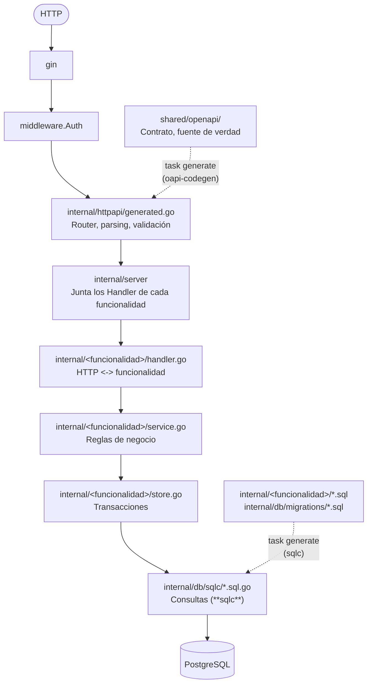

# Guía: cómo agregar un endpoint al backend

Esta guía explica, paso a paso, qué archivos tocar y qué comandos correr para agregar
una ruta nueva a la API. Todo el flujo parte del contrato OpenAPI: primero define el
endpoint en el contrato, luego genera el código y al final impleméntalo en la carpeta de
su funcionalidad.

**Nota:** Toda la guía usa de ejemplo el agregar
`GET /v1/reportes/{reporteId}`, que devuelve un reporte por su id.

---

## Diagrama de arquitectura



Las flechas sólidas muestran el recorrido de una petición; las punteadas, el código que
genera `task generate`.

### Una carpeta por funcionalidad

Todo lo de un concepto del dominio vive junto, en `internal/<funcionalidad>/`:
`reporte`, `incidente`, `comentario`, `usuario` (auth, usuarios y roles) y `multimedia`.

| Archivo | Qué contiene | Qué **no** contiene |
|---|---|---|
| `<funcionalidad>.sql` | El SQL anotado para **sqlc**. | - |
| `model.go` | Los tipos propios (`Detalle`, `Nuevo`, parámetros de transacciones) y las reglas puras (`ValidarTransicion`). | Lo que ya genera **sqlc**: esos tipos se usan tal cual (`sqlc.Reporte`). |
| `errors.go` | Los `Err…` de la funcionalidad y `ReglasHTTP`, que dice con qué status y mensaje responde la API cada uno. | - |
| `store.go` | `Store`: embebe `*sqlc.Queries` y agrega las operaciones de varias sentencias, en una transacción (`db.ExecTx`) que también registra el evento en el historial. | Reglas de negocio. |
| `service.go` | `Service`: las reglas de negocio. Declara la interfaz `store` con solo lo que usa y traduce los errores de Postgres a sus `Err…`. | Nada de HTTP ni de tipos de `httpapi`. |
| `handler.go` | `Handler`: implementa las operaciones del contrato de la funcionalidad. Saca el usuario del contexto, llama al servicio y convierte el resultado al tipo del contrato. | Lógica de negocio ni SQL. |

Una funcionalidad **no importa a otra**. Si necesita leer datos de otra tabla (como el
detalle de un reporte con sus comentarios), escribe su propia consulta y sus propios
tipos. La única excepción es `historial`, que todas usan dentro de sus transacciones.

### Paquetes compartidos

| Paquete | Qué hace |
|---|---|
| `internal/httpapi/` | Solo el código que genera **oapi-codegen** (`generated.go`) y la página de docs. |
| `internal/server/` | El único que conoce a todas las funcionalidades: arma el router, junta sus `Handler` en la interfaz del contrato, junta sus `ReglasHTTP` en la tabla de errores y construye los servicios (`server.New`). |
| `internal/db/` | Conexión, migraciones (`migrations/`), `ExecTx` y los helpers de errores de Postgres (`IsNotFound`, `IsUniqueViolation`, `IsForeignKeyViolation`). |
| `internal/db/sqlc/` | Las consultas y modelos que genera **sqlc**, en un solo paquete. |
| `internal/httperr/` | La tabla de errores (`Regla`, `Tabla`) y los errores de transporte (`ErrNoAutenticado`, …). No importa a ninguna funcionalidad. |
| `internal/historial/` | `Registrar`, para guardar quién hizo qué dentro de una transacción. |
| `internal/almacen/` | El cliente HTTP del servicio multimedia, que guarda y borra archivos. |

### Archivos generados

| Archivo | Lo genera | A partir de |
|---|---|---|
| `internal/httpapi/generated.go` | **oapi-codegen** | `shared/openapi/openapi.yaml` |
| `internal/db/sqlc/*.go` | **sqlc** | los `.sql` listados en `sqlc.yaml` + migraciones |

No edites estos archivos a mano.

---

## Requisitos

- Go (la versión de `go.mod`).
- [Task](https://taskfile.dev/installation/) para correr los comandos del `Taskfile.yml`.
- [sqlc](https://docs.sqlc.dev/en/latest/overview/install.html).
- [golang-migrate](https://github.com/golang-migrate/migrate/tree/master/cmd/migrate) (`migrate`).
- `oapi-codegen` no se instala aparte: está fijado como `tool` en `go.mod` y se ejecuta
  con `go tool oapi-codegen` (el `Taskfile` ya lo hace así).
- Docker, para los tests de integración.

Corre todos los comandos `task` desde la carpeta `backend/`.

---

## Guía paso a paso

### Resumen

| # | Paso | Archivo(s) |
|---|---|---|
| 1 | Crea la migración de esquema (si hace falta) | `internal/db/migrations/NNN_nombre.{up,down}.sql` |
| 2 | Define el endpoint en el contrato | `shared/openapi/paths/*.yaml`, `shared/openapi/schemas/**`, `shared/openapi/openapi.yaml` |
| 3 | Escribe la consulta SQL | `internal/<funcionalidad>/<funcionalidad>.sql` |
| 4 | Genera el código | `task generate` |
| 5 | Impleméntalo en la funcionalidad | `store.go` (si hace falta), `service.go`, `errors.go`, `handler.go` |
| 6 | Registra la funcionalidad (solo si es nueva) | `internal/server/`, `sqlc.yaml` |
| 7 | Escribe los tests y verifica | `service_test.go`, `internal/server/*_integration_test.go`, `task test` |
| 8 | Regenera los tipos del frontend | `pnpm generate:types` (desde la raíz) |

### Paso 1: Crea la migración (solo si cambia el esquema)

Si el endpoint necesita una tabla o columna nueva, crea un par de archivos con el
siguiente número de la secuencia:

```
internal/db/migrations/002_agregar_algo.up.sql
internal/db/migrations/002_agregar_algo.down.sql
```

- `up` aplica el cambio; `down` lo revierte **exactamente** (una migración sin `down`
  correcto no se puede deshacer).
- Nunca edites una migración que ya está aplicada en otro entorno: crea una nueva.

Aplica o revierte las migraciones con:

```sh
task migrate-up                                    # usa DATABASE_URL o el valor por defecto
task migrate-up DATABASE_URL="postgres://..."      # contra otra base
task migrate-down                                  # revierte la última
```

> El ejemplo (`GET /reportes/{reporteId}`) no necesita migración: la tabla `reporte`
> ya existe.

### Paso 2: Define el endpoint en el contrato OpenAPI

El contrato está partido en tres niveles:

```
shared/openapi/
├── openapi.yaml               # índice: lista de paths y de components.schemas
├── paths/<recurso>.yaml       # operaciones agrupadas por recurso
└── schemas/<recurso>/*.yaml   # un archivo por schema
```

**2a. Crea los schemas nuevos (si hacen falta).** Crea un archivo por schema en
`schemas/<recurso>/`, con nombre en `snake_case`. Escribe también las propiedades del
JSON en `snake_case`; **oapi-codegen** las convierte a `CamelCase` en Go (`incidente_id` ->
`IncidenteId`). El ejemplo reutiliza `Reporte`, así que no necesita ninguno.

Nombres: lo que el cliente envía se llama `crear_<recurso>_request` (también cuando va
anidado en otro request, como `crear_tag_request` dentro de `crear_incidente_request`); lo que la API devuelve usa
el nombre del recurso (`tag`, `multimedia`), que además lleva los campos que asigna el
servidor (`id`, `user_id`, `created_at`). Los nombres de dominio van en español y lo
técnico o estándar (`created_at`, `latitude`, `user_id`) en inglés.

**2b. Agrega la operación** en `paths/reportes.yaml`. Cada clave de primer nivel del
archivo es un *path item* (todas las operaciones de una misma URL), y `openapi.yaml` la
referencia:

```yaml
obtenerReporte:
  get:
    operationId: obtenerReporte
    parameters:
      - name: reporteId
        in: path
        required: true
        schema:
          type: string
          format: uuid
    responses:
      '200':
        description: Reporte encontrado
        content:
          application/json:
            schema:
              $ref: '#/components/schemas/Reporte'
      '401':
        description: No autenticado
        content:
          application/json:
            schema:
              $ref: '#/components/schemas/ErrorResponse'
      '404':
        description: Reporte no encontrado
        content:
          application/json:
            schema:
              $ref: '#/components/schemas/ErrorResponse'
```

Convenciones y buenas prácticas:

- Escribe el **`operationId` en `camelCase` y en español** (`crearReporte`,
  `obtenerReporte`, `listarComentarios`). De él salen todos los nombres que se generan
  en Go (ver paso 4).
- Si el método va en una URL que **ya existe** (p. ej. `GET /reportes` junto al
  `POST /reportes`), agrégalo como otra clave (`get:`) dentro del mismo path item en
  vez de crear uno nuevo: una URL = un path item.
- Declara **todas** las respuestas que el handler puede devolver (incluidos los
  `4xx`). **oapi-codegen** solo genera tipos para las respuestas declaradas.
- Declara los ids como `type: string, format: uuid`; se mapean a `uuid.UUID` (el mismo
  tipo que usa **sqlc**, sin conversiones).
- Si agregas un schema nuevo, añádelo también al bloque `components.schemas` al final
  del archivo de path, para que el archivo se pueda resolver solo.

**Autenticación.** Por defecto **todas las rutas requieren token** (`security` global en
`openapi.yaml`). Para una ruta pública, pon `security: []` en la operación, como en
`paths/auth.yaml` (`register`, `login`). No toques el middleware: **oapi-codegen** marca las
rutas protegidas y `middleware.Auth` solo exige el header `Authorization: Bearer <jwt>`
en esas.

**2c. Registra la ruta en `openapi.yaml`.** Agrega la URL en `paths` y, si creas
schemas, agrégalos en `components.schemas`:

```yaml
paths:
  /reportes:
    $ref: './paths/reportes.yaml#/crearReporte'
  /reportes/{reporteId}:
    $ref: './paths/reportes.yaml#/obtenerReporte'
```

No incluyas `/v1` ni `/api` en las URLs del contrato: `internal/server/router.go` agrega `/v1` (`BaseURL`)
y nginx quita `/api` antes de reenviar al backend.

### Paso 3: Escribe la consulta SQL

Escribe la consulta en el `.sql` de la funcionalidad (aquí `internal/reporte/reporte.sql`),
con la anotación de **sqlc**:

```sql
-- name: GetReporteById :one
SELECT * FROM reporte WHERE id = $1;
```

| Anotación | Devuelve | Uso |
|---|---|---|
| `:one` | `(T, error)`; `pgx.ErrNoRows` si no hay fila | buscar uno |
| `:many` | `([]T, error)` | listados |
| `:exec` | `error` | `UPDATE`/`DELETE` sin retorno |

- Nombra las consultas en inglés y en `PascalCase`: `CreateX`, `GetXByID`, `ListXByY`,
  `UpdateX`, `DeleteX`.
- Para parámetros con nombre o casts, usa `sqlc.arg(nombre)`
  (ver `CreateLocation` en `reporte.sql`).
- Los tipos se mapean según `sqlc.yaml`: `uuid` -> `uuid.UUID`, `timestamptz` ->
  `time.Time`, columnas `NULL` -> punteros (`*string`, `*int`, `*time.Time`).

### Paso 4: Genera el código

```sh
task generate
```

Este comando corre `go tool oapi-codegen` (contrato -> `internal/httpapi/generated.go`) y
`sqlc generate` (SQL -> `internal/db/sqlc/`). Después de esto el build **falla a
propósito**: `internal/server/router.go` tiene la aserción
`var _ httpapi.StrictServerInterface = api{}` y ninguna funcionalidad implementa todavía
el método nuevo. El error del compilador te dice cuál falta.

Nombres que se generan a partir de `operationId: obtenerReporte`:

| Generado | Para qué |
|---|---|
| `ObtenerReporte(ctx, httpapi.ObtenerReporteRequestObject) (httpapi.ObtenerReporteResponseObject, error)` | método que implementa el `Handler` |
| `httpapi.ObtenerReporteRequestObject` | parámetros de path/query en campos (`ReporteId`) y el body en `.Body` |
| `httpapi.ObtenerReporte200JSONResponse`, `httpapi.ObtenerReporte404JSONResponse`, … | un tipo por cada respuesta declarada |

A partir de `-- name: GetReporteById :one` se genera el método
`(*sqlc.Queries).GetReporteById(ctx, id uuid.UUID) (sqlc.GetReporteByIdRow, error)`, que
también está disponible en el `Store` de cada funcionalidad porque este embebe
`*sqlc.Queries`.

### Paso 5: Impleméntalo en la funcionalidad

Todo este paso ocurre en `internal/reporte/`.

**5a. `store.go`, solo para operaciones de varias sentencias.** Si el endpoint escribe en
más de una tabla y todo debe quedar o nada, agrega un método al `Store` que use
`db.ExecTx` y registre el evento con `historial.Registrar` dentro de la misma transacción
(ver `CreateReporte` o `CambiarEstadoReporte`). Si necesita un struct de parámetros
propio, defínelo en `model.go` con un nombre que no choque con los de **sqlc**
(`CreateTxParams`). Para una consulta simple, como la del ejemplo, omite este paso: el
método generado ya está disponible en el `Store`.

**5b. `service.go`.** Agrega el método del store a la interfaz `store` del servicio, con la
firma exacta de **sqlc**; así el `Store` la cumple sin adaptadores y los tests pueden usar
un falso:

```go
type store interface {
    GetReporteById(ctx context.Context, id uuid.UUID) (sqlc.GetReporteByIdRow, error)
    // …
}
```

Implementa el método de negocio y traduce los errores de Postgres con los helpers de
`internal/db`:

```go
// Obtener devuelve el reporte con el id dado.
func (s *Service) Obtener(ctx context.Context, id uuid.UUID) (Detalle, error) {
    r, err := s.store.GetReporteById(ctx, id)
    if db.IsNotFound(err) {
        return Detalle{}, ErrNotFound
    }
    if err != nil {
        return Detalle{}, err
    }
    // …
}
```

Nombra los métodos del servicio en español, con la acción que realizan (`Crear`,
`Obtener`, `Listar`); deja las consultas de **sqlc** en inglés.

**5c. `errors.go`.** Si el error es nuevo, decláralo y dale su regla en `ReglasHTTP`:

```go
var ErrNotFound = errors.New("reporte not found")

var ReglasHTTP = []httperr.Regla{
    {Err: ErrNotFound, Status: http.StatusNotFound, Message: "reporte no encontrado"},
    // …
}
```

Un error sin regla llega al cliente como `500`. Agrégalo también a la lista de
`TestResolver_TodosLosErroresDeDominio` en `internal/httperr/httperr_test.go`.

**5d. `handler.go`.** Implementa el método generado sobre `*Handler`:

```go
// ObtenerReporte devuelve un reporte por su id.
func (h *Handler) ObtenerReporte(ctx context.Context, request httpapi.ObtenerReporteRequestObject) (httpapi.ObtenerReporteResponseObject, error) {
    r, err := h.svc.Obtener(ctx, request.ReporteId)
    if err != nil {
        return nil, err
    }

    return httpapi.ObtenerReporte200JSONResponse(toReporte(r)), nil
}
```

Reglas del handler:

- **Devuelve los errores con `return nil, err`.** El servidor los responde con la tabla de
  errores: `ErrNotFound` sale como `404 {"message": "reporte no encontrado"}`. Lo que no
  tiene regla sale como `500 {"message": "internal server error"}` y el detalle va al log;
  el error real nunca llega al cliente.
- **Usa un tipo de respuesta del contrato con `err == nil` solo cuando la respuesta
  depende de la operación** y no del error, como el `400` de `CrearReporte` cuando el
  incidente no existe.
- **Obtén el usuario autenticado** con `middleware.UserIDFromContext(ctx)` (solo en rutas
  protegidas). Si no está, devuelve `nil, httperr.ErrNoAutenticado`.
- El código generado rechaza con `400` los bodies con JSON inválido y los parámetros mal
  formados (p. ej. un `reporteId` que no es uuid) antes de llegar al handler. Pon en el
  handler las validaciones que el schema no expresa (longitudes en bytes, reglas
  cruzadas) y devuelve el `400` del contrato (ver `Register` en
  `internal/usuario/auth_handler.go`).
- Convierte aquí los tipos de la funcionalidad al tipo del contrato con un helper `toX`
  (como `toReporte`).

### Paso 6: Registra la funcionalidad (solo si es nueva)

Si el endpoint es de una funcionalidad que ya existe, omite este paso: la ruta se
registra sola con `httpapi.RegisterHandlersWithOptions`.

Si creas una **funcionalidad nueva** (p. ej. `internal/notificacion/`):

1. Crea la carpeta con los archivos del paso 5, más `NewStore`, `NewService` y
   `NewHandler`.
2. Agrega su `.sql` a la lista `queries` de `sqlc.yaml`.
3. En `internal/server/router.go`, agrega el campo a `Handlers`, un alias a la lista de
   alias y el campo embebido en `api` (cada funcionalidad llama `Handler` a su handler, y
   el alias evita que dos campos embebidos se llamen igual):

   ```go
   type Handlers struct {
       // …
       Notificaciones *notificacion.Handler
   }

   type (
       // …
       notificaciones = notificacion.Handler
   )

   type api struct {
       // …
       *notificaciones
   }
   ```

   Pásalo también donde se arma el `api{…}` y agrega sus reglas a la tabla de errores
   (`httperr.NewTabla(…, notificacion.ReglasHTTP)`).
4. En `internal/server/server.go`, construye el handler en `server.New` sobre el mismo
   `pool`: `notificacion.NewHandler(notificacion.NewService(notificacion.NewStore(pool)))`.
   No abras otro pool.
5. Haz lo mismo en `newTestClient` de `internal/server/router_integration_test.go`.

No registres rutas del contrato a mano con `r.GET(...)`: esas rutas no pasan por el
middleware de auth ni por la validación generada. Usa `r.GET` directo solo para rutas
fuera del contrato (`/health`, `/v1/openapi.json`).

### Paso 7: Escribe los tests y verifica

Agrega o actualiza el `service_test.go` de la funcionalidad, con un falso en memoria del
store, y un test de integración en `internal/server/` si el endpoint es nuevo. Sigue las
convenciones de [`TESTING.md`](TESTING.md); en resumen: usa el mismo paquete, nombra las
funciones `TestTipo_Comportamiento` y haz que el falso devuelva los mismos errores que
Postgres (`pgx.ErrNoRows`, `*pgconn.PgError` con código `23505`).

Verifica con:

```sh
go build ./...        # confirma que las funcionalidades implementan todo el contrato
go vet ./...
task test             # go test ./... -v (con Docker corriendo, ver TESTING.md)
task run              # levanta la API en local
```

Prueba el endpoint a mano (con el backend en `localhost:8080`):

```sh
curl -H "Authorization: Bearer <token>" http://localhost:8080/v1/reportes/<uuid>
```

Obtén el token con `POST /v1/auth/login`. A través de nginx (Docker completo), usa la URL
`http://localhost/api/v1/...`.

### Paso 8: Regenera los tipos del frontend

El contrato también genera los tipos de TypeScript que usan web y móvil. Corre desde la
**raíz** del repo:

```sh
pnpm generate:types   # escribe shared/types/api-types.ts
```

---

## Comandos de referencia

Desde `backend/`:

| Comando | Qué hace |
|---|---|
| `task generate` | Regenera `internal/httpapi/generated.go` e `internal/db/sqlc/` |
| `task generate-check` | Regenera y falla si hay diferencias con lo commiteado |
| `task migrate-up` / `task migrate-down` | Aplica / revierte migraciones |
| `task test` | Corre todos los tests |
| `task run` | Levanta la API |
| `go build ./...` | Verifica que el contrato esté implementado completo |

Desde la raíz: `pnpm generate:types`.

---

## Problemas comunes

| Síntoma | Causa probable |
|---|---|
| `api does not implement httpapi.StrictServerInterface (missing method X)` | Ninguna funcionalidad implementa el handler del `operationId` nuevo, la firma no coincide, o falta embeber la funcionalidad en `api` (`internal/server/router.go`). |
| La misma aserción falla con un método que sí existe | Dos funcionalidades implementan la misma operación y el método queda ambiguo. |
| `Handler redeclared` en `internal/server` | Se embebió `*x.Handler` directo; usa un alias por funcionalidad. |
| Un error esperado responde `500` | Al `Err…` le falta su regla en `ReglasHTTP`, o la funcionalidad no está en `httperr.NewTabla(…)`. |
| `401 missing Authorization header` en una ruta que debería ser pública | Falta `security: []` en la operación. |
| `UserIDFromContext` devuelve `false` en una ruta protegida | Falta `r.ContextWithFallback = true` en `internal/server/router.go`. |
| El schema nuevo no aparece como tipo con nombre en Go | No está listado en `components.schemas` de `openapi.yaml`. |
| **sqlc** no encuentra una tabla o columna | Falta la migración, o tiene un error de sintaxis (**sqlc** lee las migraciones como esquema). |
| **sqlc** no genera la consulta nueva | El `.sql` de la funcionalidad no está en la lista `queries` de `sqlc.yaml`. |
| Los tests de una funcionalidad no compilan | La interfaz `store` tiene un método que el falso no implementa. |
| Los tests de integración terminan demasiado rápido | Docker no está corriendo y se saltaron (`SKIP`). |
| `404` en una ruta que sí está en el contrato | La URL de la petición no lleva `/v1`, o falta correr `task generate`. |
